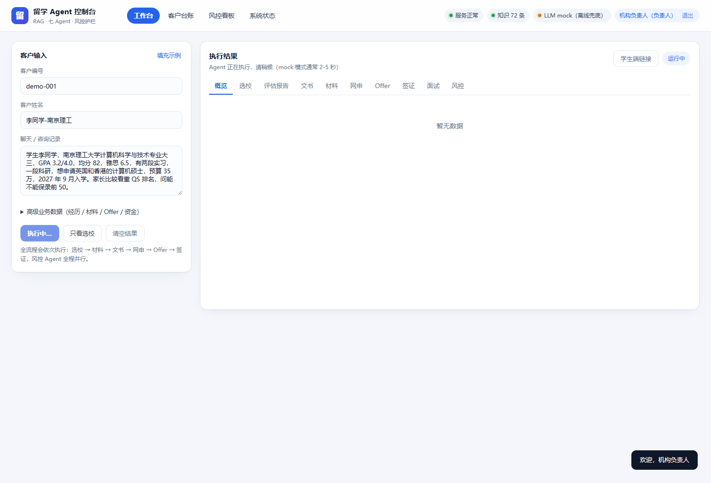
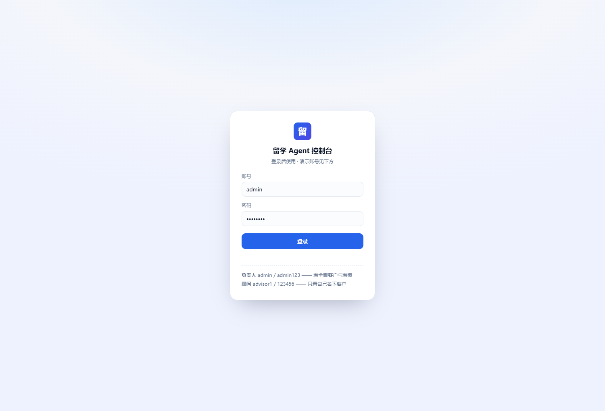
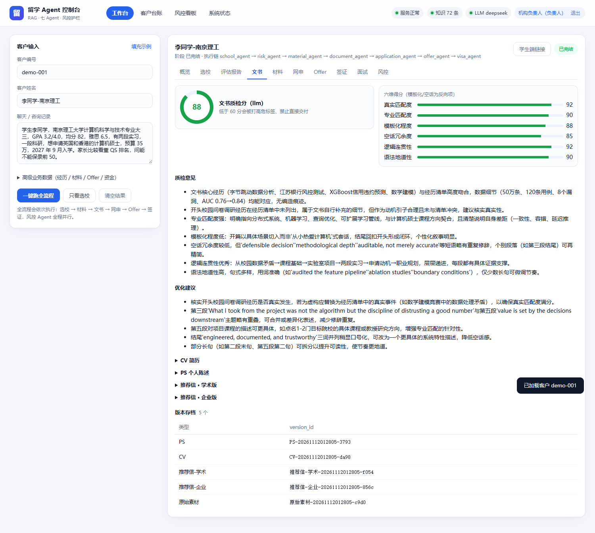
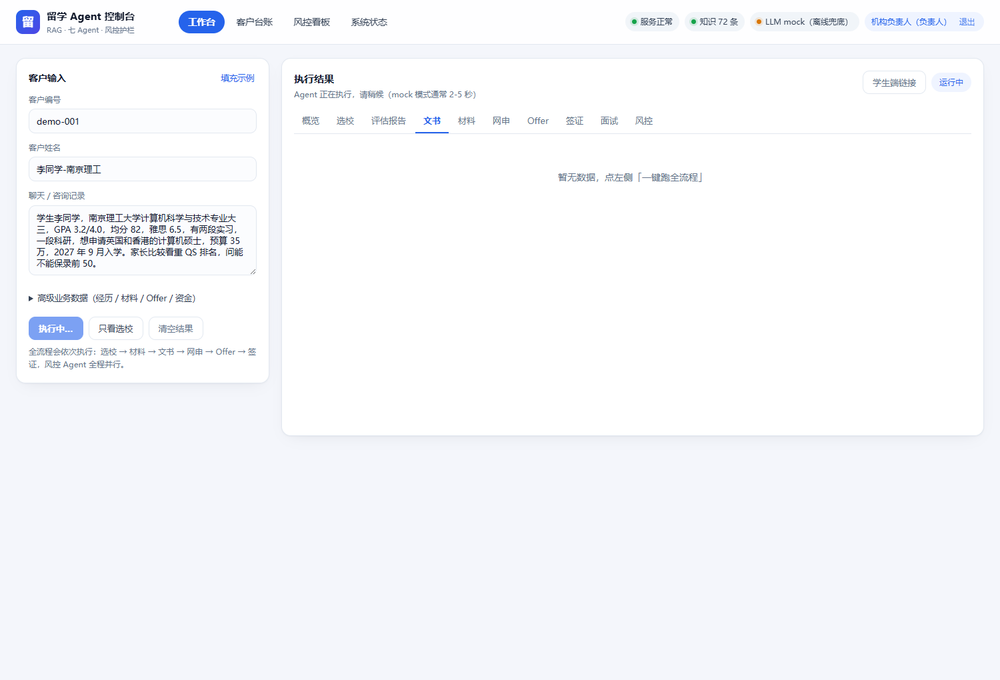
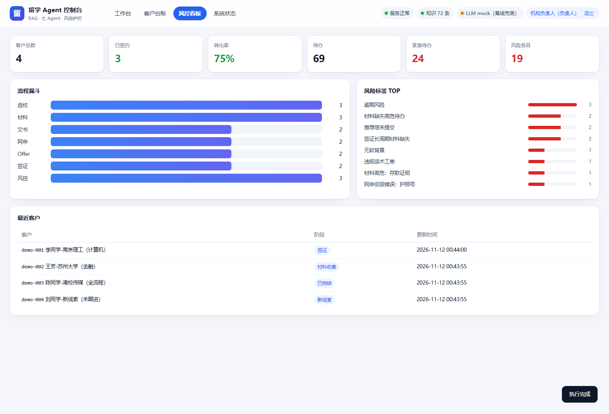
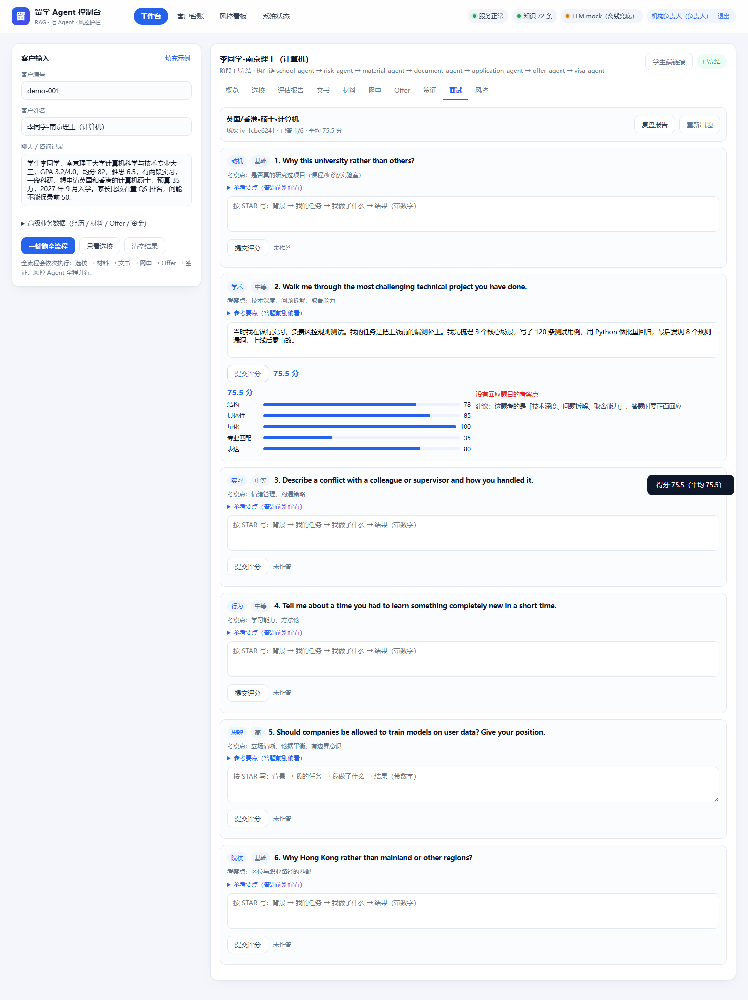
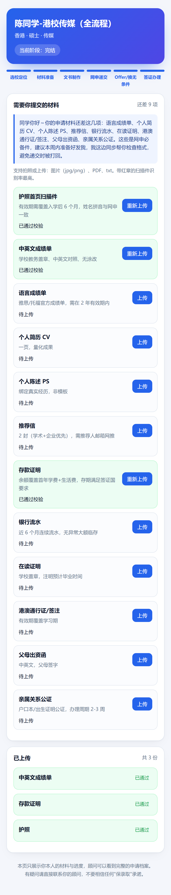

# 留学全流程智能顾问 Agent 系统

[](https://github.com/Liu-97-coder/study-abroad-agent/actions/workflows/ci.yml)


> 按语雀《项目经验扩展库（黑马鹏鹏讲AI）》11 篇文档落地的**可运行工程**。
> RAG + 七 Agent 编排 + 客户中台 + 风控护栏 + Web 控制台。
> 不配 API Key 也能把「线索 → 签证」全流程跑完（规则兜底），配好 Key 同一套代码自动切真实模型。



---

## 1. 这个项目到底在解决什么

原文档先拆业务，再拆系统。这张表把「业务卡点 → 系统能力 → 代码位置」对齐：

| 业务卡点（01 业务调研） | 系统能力 | 代码入口 |
| --- | --- | --- |
| 顾问选校慢、新人定位不准 | 三档选校 + 难度指数 + 风险标注 | `phase1/school_agent/` |
| 文书产能失控、无限返工 | CV/PS/推荐信 + 六维质检 + 版本固化 | `phase1/doc_agent/` |
| 材料反复催、格式不合规 | 个性化清单 + 规则校验 + 阶梯催收 | `phase2/material_agent/` |
| 漏截止、填错网申、推荐人不交 | 表单预校验 + 邮件意图 + 三级倒计时 | `phase2/app_agent/` |
| Offer 条件看不懂、押金/CAS 踩坑 | Con 条件解析 + 达标风险 + CAS 时间线 | `phase2/offer_agent/` |
| 签证资金材料出错被拒签 | 资金四维风险 + 递签时间线 | `phase2/visa_agent/` |
| 顾问乱承诺、离职带走客户 | 合规巡检 + 高危预判 + 一键交接 | `phase3/risk_agent/` |

三层架构（02 篇）：

```
前台对话 Agent  ── 咨询 / 选校 / 话术 / 纪要
业务作业 Agent  ── 材料 / 文书 / 网申 / Offer / 签证
管理管控 Agent  ── 合规 / 高危预判 / 交接
──────── 底座：RAG 知识库 · LangGraph 编排 · 客户中台 · 安全护栏 ────────
```

---

## 2. 技术栈

| 层 | 选型 | 说明 |
| --- | --- | --- |
| 语言 | Python 3.10+ | 全项目类型标注 |
| Web | FastAPI + Pydantic v2 | 自动 `/docs` |
| 控制台 | 原生 HTML/CSS/JS（零构建） | 由 FastAPI 直接托管，改完刷新即生效 |
| 编排 | LangGraph（可选降级） | 未安装时退回等价路由循环 |
| 向量库 | local JSON / Milvus | 默认 local，零依赖 |
| Embedding | hashing 1024 维 / OpenAI 兼容 | 默认离线，可换 bge / text-embedding-3 |
| 大模型 | OpenAI 兼容协议（DeepSeek 已验证） | `LLM_PROVIDER=mock` 时走规则与模板 |
| OCR | rapidocr（ONNX）/ PaddleOCR | 图片证件识别，Windows 免编译；默认 stub 也会自动尝试 rapidocr |
| 存储 | SQLite（客户中台） | 客户/待办/风险/文书版本 |
| 测试 | pytest（44 用例） | 覆盖基座 + 选校链路 + 接口契约 |

---

## 3. 快速开始

```powershell
cd study-abroad-agent
powershell -ExecutionPolicy Bypass -File scripts\setup.ps1    # 建环境 + 装依赖 + 灌库 + 自测
powershell -ExecutionPolicy Bypass -File scripts\setup.ps1 -SkipSmoke   # 只想装环境
```

生成演示数据（4 个不同阶段的客户，看板一打开就有内容）：

```powershell
.\.venv\Scripts\python.exe scripts\seed_demo.py --reset
```

启动服务：

```powershell
powershell -ExecutionPolicy Bypass -File scripts\dev.ps1
# 或直接双击 启动服务.bat（端口被占用会自动顺延，以窗口打印的地址为准）
```

打开这两个地址：

| 地址 | 内容 |
| --- | --- |
| `http://127.0.0.1:8000/` | **Web 控制台**（顾问工作台 / 客户台账 / 风控看板 / 系统状态） |
| `http://127.0.0.1:8000/docs` | 接口文档（Swagger，可直接调） |

> 完全没用过终端？看 **[docs/手把手操作手册.md](docs/手把手操作手册.md)**，
> 从"装 Python"开始，每一步都有命令和预期结果。

---

## 4. Web 控制台

### 4.0 登录（鉴权默认开启）



| 账号 | 密码 | 权限 |
| --- | --- | --- |
| `admin` | `admin123` | 机构负责人：看全部客户、看板、账号管理 |
| `advisor1` | `123456` | 顾问：**只看自己名下客户**（越权访问返回 403） |
| `advisor2` | `123456` | 顾问：同上 |

Token 为自签 HS256（`ai_agent_core/auth.py`，零第三方依赖），默认 8 小时过期；
密码用 PBKDF2 加盐存储。生产务必改 `.env` 里的 `AUTH_SECRET`，否则任何人都能伪造 token。

### 4.1 工作台（左边输入 → 右边 8 个 Tab）

> 接上真实模型后，文书页会变成这样：**质检 88 分（LLM 打分）**，六维全绿，
> 质检意见能指出"开头校园问卷经历未在记录中出现，建议核实真实性"这种具体问题。



左边填聊天记录（可一键填充示例），点「一键跑全流程」，右边按 Agent 分 Tab 展示产出：


- **选校**：冲刺/匹配/保底三列，每条显示难度分、硬门槛、截止天数、风险点；点卡片展开五维打分明细
- **评估报告**：完整 Markdown（硬件/优势/短板/窗口/评级/建议），底部标数据来源
- **文书**：质检环形分 + 六维条 + CV/PS/推荐信折叠块 + 版本 ID
- **材料 / 网申 / Offer / 签证 / 风控**：清单、校验、时间线、工单



### 4.2 客户台账

按最近更新排序，显示编号/姓名/阶段/更新时间，点「打开」把该客户完整档案与 AI 产出加载回工作台。
这就是"人员离职交接不掉链子"的物理落点。

### 4.3 风控看板



- 六个 KPI：客户数 / 已签约 / 转化率 / 待办 / 紧急待办 / 风险条目
- **流程漏斗**：按"客户是否已产出该 Agent 的结果"统计，比只看当前阶段更有信息量
- **风险标签 TOP**：材料缺失、逾期、推荐信未提交…
- 最近客户列表

### 4.6 面试 Tab（第八个 Agent）



- 按目标专业/国家抽 **6 道题**，题型强制有梯度：动机 → 学术 → 实习 → 行为 → 思辨 → 院校
- 每题有「考察点」和可折叠的「参考要点」，学生先答再看
- 提交后按 **结构(STAR) / 具体性 / 量化 / 专业匹配 / 表达** 五维打分，并给一条最关键的整改建议
- 「复盘报告」汇总最弱三题、五维平均、下一步动作

设计上它是**可选 Agent**：只有 `student_info.interview_requested=True` 且阶段到
`application`/`offer` 才会被路由唤醒，主流程完全不受影响 —— 这是"插件式扩展"的实证。

### 4.7 系统状态

知识库条数（四个库分开）、LLM 是否连真实模型、RAG/Embedding/OCR 后端、原始统计 JSON。

### 4.5 学生端（材料上传 + 进度查看）

工作台右上角点「学生端链接」，会生成一个带 `access_key` 的免登录地址并发给学生：



学生只需要：看到自己还差哪些材料 → 点「上传」→ 系统 OCR 解析 + 规则校验 →
当场告诉他「通过了」还是「存期不够，需再存 6 天」。

安全边界：
- 学生端只拿得到**自己的**材料清单与进度，看不到风险工单、顾问话术、其他客户
- 链接无效返回 404；上传限制 10MB；文件名重命名后落 `runtime/uploads/{客户}/`
- 上传即校验（`material_rule_checker`），不合格项直接给出整改建议

---

## 5. 七个 Agent 一览

| Agent | 输入 | 依赖底座 | 输出 | 触发阶段 |
| --- | --- | --- | --- | --- |
| `school_agent` | 聊天/表单文本 | 院校 RAG | 三档清单、评估报告、纪要、话术、追问 | `clue` / `consult` |
| `document_agent` | 经历素材 + 目标专业 | 文书 RAG | CV、PS、推荐信、质检分、版本 ID | `document` |
| `material_agent` | 国家/学位/在读状态 + 上传文件 | 签证 RAG + OCR | 材料清单、校验风险、缺失待办、催收文案 | `signed` / `material` |
| `application_agent` | 网申表单 + 院校邮件 | 院校截止库 | 表单错误、邮件意图、截止预警、推荐人待办 | `application` |
| `offer_agent` | Offer 文件 | 院校政策库 + OCR | Con 条件、达标风险、押金规则、CAS 时间线 | `offer` |
| `visa_agent` | 资金材料 + CAS/入境时间 | 签证 RAG + OCR | 材料包、资金风险、递签时间线 | `visa` |
| `interview_agent` | 目标专业/国家 + 学生作答 | 面试题库 RAG | 6 道模拟题、五维评分、复盘报告 | 被标记时（`application`/`offer`） |
| `risk_agent` | 全流程状态 + 聊天记录 | 内控库 | 合规工单、风险分与标签、交接清单 | 每步并行（只读） |

状态机：`clue → consult → signed → material → document → application → offer → visa → finished`

> **红线**：`auto_advance=True` 只用于演示/自测。生产每一步都要顾问确认，
> 对应 PRD 第八条（AI 不自主决策），代码里靠 `graph_engine.PIPELINE` 隔离。

---

## 6. 目录地图

```
study-abroad-agent/
├── ai_agent_core/
│   ├── config.py                 全局配置（LLM/RAG/OCR/权重/阶段）
│   ├── storage.py                客户中台（SQLite：客户/待办/风险/文书版本）
│   ├── main.py                   FastAPI 入口 + 控制台托管
│   ├── schema/                   Pydantic 结构体（状态/学生/选校/文书/材料/网申/Offer/签证）
│   ├── base/                     ★ 底层基座
│   │   ├── rag_client.py         RAG：四库隔离 / 三段检索 / 增量 / 溯源 / 分片
│   │   ├── ocr_client.py         OCR：分类 / 实体抽取 / 脱敏 / 容错
│   │   ├── graph_engine.py       LangGraph 调度：状态机 / 分支 / 并行风控
│   │   ├── base_agent.py         Agent 基类：统一出入参 / 埋点 / 兜底 / 待办去重
│   │   ├── safety_middleware.py  护栏：关键词 → 语境 → 语义 → 幻觉溯源
│   │   ├── llm_dispatch.py       LLM 池：分层 / 缓存 / 限流 / 重试
│   │   ├── logger_trace.py       Trace：trace_id / JSONL / 按客户回查
│   │   └── context.py            依赖装配（单例）
│   ├── phase1/                   选校 Agent + 文书 Agent（08 篇）
│   ├── phase2/                   材料 / 网申 / Offer / 签证（09 篇）
│   ├── phase3/                   合规 / 高危预判 / 交接（10 篇 + PRD 六）
│   ├── prompt/                   全局 Prompt 库
│   └── api/                      FastAPI 路由（选校/文书/材料/网申/Offer/签证/调度/中台/看板）
├── web/                          ★ 控制台（index.html / app.js / style.css / favicon）
│   └── student.html · student.js 学生端（材料上传 + 进度）
├── data/seed/                    知识库种子（院校 CSV / 签证政策 / 文书素材 / 合规词库）
├── scripts/
│   ├── setup.ps1 / dev.ps1 / stop.ps1 / reset.ps1   安装 / 启动 / 停止 / 重置
│   ├── ingest_seed.py            知识库灌库
│   ├── seed_demo.py              生成 4 个演示客户
│   ├── check_rag.py              RAG 检索诊断
│   ├── check_llm.py              LLM 接入自检（配 mock_llm_server 用）
│   ├── check_auth.py             鉴权与数据隔离自检
│   ├── check_student.py          学生端自检
│   ├── check_milvus.py           Milvus 后端自检
│   ├── mock_llm_server.py        OpenAI 兼容假模型（零成本联调）
│   ├── set_llm_key.py            一条命令接入真实 Key（备份/验证/自动回滚）
│   ├── check_real_run.py         真实模型跑一遍全流程，报告 token 与耗时
│   ├── try_school.py             一条命令跑选校并翻译成人话
│   ├── screenshot.py             用 Edge 给控制台/学生端拍截图
│   ├── healthcheck.py            容器健康检查（Dockerfile HEALTHCHECK 用）
│   ├── check_deploy.py           部署等价验证（干净 venv 只装 requirements）
│   ├── docker-up.ps1             一键：查 Docker → 构建 → 等 healthy → 打印地址
│   ├── install-docker.ps1        装 Docker Desktop（UAC 提权 + WSL2 检查）
│   ├── check_prod.py             容器 CMD 等价验证（0.0.0.0 + 健康检查 + 局域网）
│   ├── smoke_test.py             端到端自测（12 项断言）
│   └── api_smoke.py              接口契约自测
├── tests/                        pytest（59 个用例）
├── docs/                         手把手 / 一步步 / 架构决策 / 面试对照 / 部署 / 接口示例 / 截图
├── Dockerfile · docker-compose.yml
├── requirements.txt · requirements-dev.txt
└── 启动服务.bat · 停止服务.bat · 打开项目.bat · 安装Docker.bat · 启动Docker.bat
```

---

## 7. 配置（`.env`）

| 变量 | 默认 | 可选值 / 说明 |
| --- | --- | --- |
| `LLM_PROVIDER` | `mock` | `deepseek` / `openai` / `ollama` |
| `LLM_BASE_URL` | `https://api.deepseek.com/v1` | Ollama 填 `http://127.0.0.1:11434/v1` |
| `LLM_API_KEY` | 空 | 真实模型 Key |
| `LLM_MODEL_BIG` / `SMALL` | `deepseek-chat` | 大模型写文书/评估，小模型做抽取/纪要 |
| `RAG_BACKEND` | `local` | `milvus`（需 `pip install pymilvus milvus-lite`，已验证） |
| `MILVUS_SERVER_URI` | 空 | 连独立 Milvus 填 `http://127.0.0.1:19530`；空则用本地 Lite 文件 |
| `MILVUS_LOCAL_PATH` | `./runtime/milvus_demo.db` | Milvus Lite 数据库路径（**别用 `MILVUS_URI` 这个名字**） |
| `EMBED_BACKEND` | `hashing` | `openai`（走 `/embeddings`） |
| `OCR_BACKEND` | `stub` | `paddleocr` |
| `USE_LANGGRAPH` | `1` | `0` 强制走内置路由 |
| `SAFETY_STRICT` | `1` | 高危话术是否硬拦截 |
| `AUTH_ENABLED` | `1` | `0` 关闭鉴权（脚本/测试用，所有人视为管理员） |
| `AUTH_SECRET` | `dev-secret-...` | **生产必须换成随机 32 字节** |
| `AUTH_TTL` | `28800` | Token 有效期（秒） |

接真实模型（Key 从 <https://platform.deepseek.com> 的「API keys」创建，充值 10 元即可）：

```powershell
.\.venv\Scripts\python.exe scripts\set_llm_key.py --key sk-xxxx
# 备份 .env → 写入 → 真发一次请求验证 → 失败自动回滚
.\.venv\Scripts\python.exe scripts\set_llm_key.py --show      # 看当前配置（Key 打码）
.\.venv\Scripts\python.exe scripts\set_llm_key.py --restore   # 回滚
```

也可以手改 `.env` 这三行（改完**必须重启服务**）：

```bash
LLM_PROVIDER=deepseek
LLM_API_KEY=sk-xxxx
LLM_MODEL_BIG=deepseek-chat
```

---

## 8. 接口清单

| 模块 | 接口 |
| --- | --- |
| 选校 | `POST /api/school/extract` `/match` `/report` `/talk` `/summary` |
| 文书 | `POST /api/doc/parse-experience` `/generate-cv` `/generate-ps` `/generate-ref` `/quality-check` `/version-save`，`GET /api/doc/versions` |
| 材料 | `POST /api/material/build-list` `/check-file` `/get-risk-todo` |
| 网申 | `POST /api/application/form-check` `/parse-mail`，`GET /api/application/deadline-warn` `/referee-todo` |
| Offer | `POST /api/offer/parse-offer`，`GET /api/offer/calc-cond-risk` `/cas-material-plan` |
| 签证 | `POST /api/visa/build-visa-list` `/analyze-fund`，`GET /api/visa/get-visa-timeline` |
| 调度 | `POST /api/graph/run-consult` `/run-document` `/run-material-flow` `/run-application-flow` `/run-offer-flow` `/run-visa-flow` `/run-all`，`GET /api/graph/trace/{id}` |
| 中台 | `GET /api/customer/list` `/customer/{id}` `/tasks` `/risks` `/handover` |
| 看板 | `GET /api/dashboard/overview` `/api/dashboard/health` |
| 系统 | `GET /health` `/api/system/stats` |

统一返回 `{"code":0,"message":"ok","data":{...}}`；限流单 IP 20 次/分钟。
`docs/api-examples.http` 里有 20 个可直接发送的请求（改顶部 `@base` 即可）。

---

## 9. 测试

三层 + 四个专项自检：

```powershell
# 1) 单元 + 接口（pytest，隔离临时运行目录，不动你的数据）
.\.venv\Scripts\python.exe -m pytest

# 2) 端到端业务链路（12 项断言，会写演示客户）
.\.venv\Scripts\python.exe scripts\smoke_test.py

# 3) 线上接口契约（服务需先启动）
.\.venv\Scripts\python.exe scripts\api_smoke.py --base http://127.0.0.1:8000
```

专项自检（每个都能单独跑，输出 PASS/FAIL）：

| 脚本 | 验什么 | 需要什么 |
| --- | --- | --- |
| `check_llm.py` | LLM 接入：HTTP → JSON 解析 → 缓存 → 业务链路 | 假模型 `mock_llm_server.py` 或真 Key |
| `check_auth.py` | 未登录 401 / 管理员全量 / 顾问隔离 403 / 伪造 token | 服务已启动 |
| `check_student.py` | 学生端链接、进度、上传校验、越权 404 | 服务已启动 |
| `check_milvus.py` | Milvus 建库、写入、检索、标量过滤、覆盖更新 | `pymilvus` + `milvus-lite` |
| `check_interview.py` | 出题梯度 / 五维评分 / 复盘报告 / 图调度插入 | 服务已启动 |
| `check_deploy.py` | 干净 venv 只装 requirements → 起应用 → 全链路 | 无需 Docker |
| `check_real_run.py` | 真实模型跑全流程，输出 token / 耗时 / PS 字数 / 质检分 | 已配真实 Key |

> 注：`pytest` 里的 Context 被强制为 `mock`（见 `tests/conftest.py`），
> **跑测试不花钱、不依赖网络**；想验证真实模型用 `check_real_run.py`。
| `ocr_demo.py` | 生成样例证件图 → 图片 OCR → 抽实体 | `rapidocr-onnxruntime` + `pillow` |

图片 OCR 一通，学生端就能直接拍照上传：

```powershell
.\.venv\Scripts\python.exe -m pip install rapidocr-onnxruntime pillow
.\.venv\Scripts\python.exe scripts\ocr_demo.py
# === sample_deposit.png ===  文件类型：存款证明  置信度：1.0
#   fund_amount: 400000.0   deposit_date: 2026-06-01   deposit_days: 180
# === sample_transcript.png ===  GPA: 3.6   均分: 88   专业: 计算机科学与技术
```

用假模型验证 LLM 链路（零成本）：

```powershell
# 终端 A
.\.venv\Scripts\python.exe scripts\mock_llm_server.py --port 8199
# 终端 B
.\.venv\Scripts\python.exe scripts\check_llm.py --base http://127.0.0.1:8199/v1
```

当前 **59 个 pytest 用例 + 12 项 smoke 断言 + 4 组专项自检** 全绿。测试重点不是"跑通"，而是：
分片不会退化成碎片、检索一定带 `source_id`、护栏三态判定、专业方向不串档、
顾问越权返回 403、接口返回结构不漂移。

---

## 10. 部署

三种方式，按场景选；细节见 **[docs/部署.md](docs/部署.md)**：

| 方式 | 适合 | 命令 | 状态 |
| --- | --- | --- | --- |
| 本机直跑 | 开发 / 演示 | 双击 `启动服务.bat` | ✅ 已跑通 |
| **本机常驻（推荐）** | 当内部系统用，开机自动起 | 双击 `开机自启.bat` | ✅ 已验证（隐藏窗口 + 日志 + 崩溃重启） |
| Docker | 交付给别人 / 内网试用 | 右键 `安装WSL.bat` → 重启 → 双击 `启动Docker.bat` | ⚠️ Docker 已装，缺 WSL2 内核（需管理员） |
| Linux + systemd + nginx | 正式上线 | 见部署文档 | ⚠️ 未实跑 |

**本机常驻（不需要管理员）**：`开机自启.bat` 会在启动文件夹放一个快捷方式，
登录后用 `wscript` 隐藏窗口启动 `scripts/run_server.py`：

- 监听 `0.0.0.0:8000`（局域网可访问）
- 日志 `logs/server.log`，崩溃自动重启（最多 20 次）
- 取消：双击 `取消自启.bat`

**容器三步**（安装包已在 `C:\Users\25045\Downloads\DockerDesktopInstaller.exe`）：

```powershell
# 1. 右键 安装WSL.bat -> 以管理员身份运行（Docker 前置，必须提权）
# 2. 重启电脑（WSL2 内核生效）
# 3. 双击 启动Docker.bat
```

镜像要点：`python:3.12-slim` + 非 root `appuser` + `HEALTHCHECK`（调 `scripts/healthcheck.py`，
不依赖 curl）+ 启动时先幂等灌库；`runtime/` 与 `logs/` 挂载到宿主机，重建容器不丢数据。

**没 Docker 也能证明镜像能跑**（两层等价验证，都已通过）：

```powershell
.\.venv\Scripts\python.exe scripts\check_deploy.py   # 干净 venv 只装 requirements
.\.venv\Scripts\python.exe scripts\check_prod.py     # 按容器 CMD 启动：0.0.0.0 + 健康检查 + 局域网
```

`check_prod.py` 实测：0.0.0.0 绑定 ✅ / 127.0.0.1 ✅ / **局域网 192.168.155.21 ✅** /
`healthcheck.py` 退出码 0 ✅ / 控制台与接口 200 ✅。

**手机看学生端**：同一 WiFi 下打开 `http://192.168.155.21:8000/student.html?k=xxx`（端口不通就看防火墙）。

上线前三件事：`AUTH_SECRET` 换随机值、8000 不要直接暴露公网、学生端链接必须走 HTTPS
（它是 bearer key，明文 HTTP 等于把客户材料公开）。

---

## 11. 与语雀文档的对应关系

| 语雀文档 | 对应实现 |
| --- | --- |
| 01 业务调研（七阶段 + 六大卡点） | 七个 Agent 的职责划分 |
| 02 系统功能架构（三层 + 底座） | `base/` + `phase1~3/` |
| 03 PRD（三期功能 + 风控红线） | 功能清单、`safety_middleware`、`PIPELINE` 人工确认闸门 |
| 05 工作拆解（AI 工程师视角） | 双路抽取、RAG 四库、Agent 通信协议、成本优化 |
| 06 架构流转图 + 任务清单 | `graph_engine.py` 阶段路由表 |
| 07 底层基座 | `base/` 六个模块，对应四个任务 |
| 08 一期（选校 + 文书） | `phase1/`：六段式 PS、六维质检、版本管理 |
| 09 二期（材料/网申/Offer/签证） | `phase2/`：资金四维推理、CAS 倒推时间线 |
| 10 三期（管理层模块） | `phase3/`：双层检测、多维风险打分、交接打包 |
| 11 十大亮点 + 技术难点 | [docs/面试对照.md](docs/面试对照.md)，每条指到文件 |

> 语雀第 10 篇在原站点不可见（抓取为空），三期依据 PRD 第六节 + 第 11 篇要求实现。

---

## 12. 四条设计红线

1. **AI 只给建议，不自主决策** —— 输出进 `state.agent_outputs`，顾问确认后才推进阶段。
2. **硬数据必须有 `source_id`** —— 缺溯源直接打风险标签（`safety.verify_citations`）。
3. **违规话术强制拦截** —— 关键词 + 语境（否认/询问/承诺）+ 语义复核，命中即替换。
4. **全链路留痕** —— 一个 `trace_id` 贯穿；每版文书有 `version_id`；检索结果永久绑来源。

---

## 13. 已知边界

- **真实模型已接通并验证**（DeepSeek `deepseek-chat`）：
  `check_llm.py` 8/8、真实模型下 `smoke_test.py` 12/12、PS 4197 字符地道英文、LLM 质检 88 分。
  没配 Key 时自动退回 mock（结构稿 + 经历绑定），流程照样闭环。
- **hashing 向量不是语义模型**，靠字面重合；生产换 `bge-m3` / `text-embedding-3-large`。
- **Milvus 已在 Windows + Milvus Lite 上验证通过**（灌库、检索、过滤、覆盖更新、端到端 12/12）。
  Milvus Lite 是单进程文件锁，**服务和灌库脚本不能同时写同一个 db**；生产请用独立 Milvus 服务。
- **院校/签证数据是教学样例**（33 条院校），真实项目要接当年数据 + 运营校准。
- **图片 OCR 已在 Windows 上验证**（rapidocr-onnxruntime）：存款证明、成绩单都能抽字段。
  手写体、低光照、严重倾斜的识别率仍需 `paddleocr` 或人工复核兜底。
- **PDF 需要 `pypdf`**；扫描版 PDF 仍需先转图片走 OCR。
- **鉴权是最小可用版**：无刷新 token、无密码找回、无审计日志导出；生产要接企业微信/OAuth。
- **Docker 镜像未实际构建**（本机无 Docker），Dockerfile/compose 已按标准写法给出。
- 没做多租户（一个部署服务一家机构）、消息推送（微信/短信）、学生端文件在线预览。

---

## 14. 接下来怎么练

| 阶段 | 练什么 | 验收 |
| --- | --- | --- |
| 第 1 周 | 读 `base/`，改打分权重、改分片参数 | `pytest` + `smoke_test` 仍全绿，分数变化符合预期 |
| 第 2 周 | 接真实 LLM，把 mock 兜底逐条替换 | PS 出英文成品，质检分上升 |
| 第 3 周 | 换 Milvus + 真实 embedding | `RAG_BACKEND=milvus` 下测试通过 |
| 第 4 周 | 加一个"面试模拟 Agent" + 一个页面 | 只改注册表 + 新目录，其余不动 |
| 第 5 周 | 接真实 PDF/图片 OCR | 模糊扫描件能抽 GPA/存期 |
| 第 6 周 | 加鉴权与多顾问数据隔离 | 顾问只能看自己客户 |

详细步骤：[docs/一步步实现.md](docs/一步步实现.md) · 工具操作：[docs/手把手操作手册.md](docs/手把手操作手册.md)
