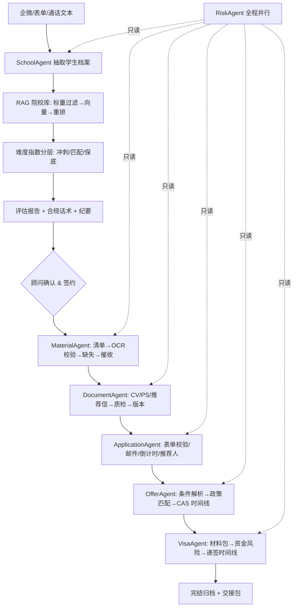

# 架构决策记录（ADR）

面试时更有说服力的不是"我用了 LangGraph"，而是"为什么这么选、代价是什么"。这里记录本项目 8 个关键取舍，每条写清问题、选择、理由、代价。

---

## 目录

- 决策 1 · 双路并行：规则 + LLM
- 决策 2 · 录取难度指数：项目难度 60% + 学生差距 40%
- 决策 3 · RAG 用三段检索，而不是"纯向量"
- 决策 4 · 每条知识必须带 `source_id`，并且一路传到前端
- 决策 5 · 状态机 + 人工确认闸门
- 决策 6 · 风控 Agent 做"并行钩子"而不是独立分支
- 决策 7 · 向量库默认 local，Milvus 作为可选后端
- 决策 8 · 一次检索、全局共享；一个客户一个 `trace_id`
- 附：数据流
- 附：如果重做一遍，我会改什么

---

## 决策 1 · 双路并行：规则 + LLM

**问题**：GPA、语言分数、截止日期一旦抽错，整个选校方案全废。

**选择**：所有关键字段先跑确定性规则（正则/表格/阈值），LLM 只做"补漏"和"文字润色"。

**理由**

- 规则可解释、可回归、零成本；模型有幻觉、有延迟、有版本漂移。
- 留学行业的核心数字（门槛、截止、存期）**错了就是客诉**，不能用概率模型兜底。

**代价**：规则需要持续维护（院校库字段一变就要改）；规则与 LLM 冲突时要写"谁优先"的策略。

**代码**：`phase1/school_agent/student_extract.py`（`extract_by_rules` + `extract_student` 合并）、`phase2/*/` 各 `*_rule_checker.py`。

---

## 决策 2 · 录取难度指数：项目难度 60% + 学生差距 40%

**问题**：原文档给了"75-100 冲刺 / 50-75 匹配 / 0-50 保底"，但没给打分公式。
第一版按"学生差多少"加权，结果 3.2/6.5 的学生看所有学校都是"保底"——不真实。
第二版只看 QS 排名，又变成"3.2 冲 NUS"——也不真实。

**选择**

```
难度指数 = 60% 项目难度（QS + 硬门槛）
         + 15% GPA 差距
         + 10% 语言差距
         +  5% 院校背景差距
         + 10% 截止紧迫度
```

**理由**：顾问脑子里的判断本来就是"这学校多难 + 我差多少"两件事。
拆开加权后，每条结果都能给出一句话解释："曼大本身 QS 34，我 GPA 差 0.1"。

**代价**：QS 排名不是唯一难度指标（录取率、专业冷热都没进模型）。
真实项目应该用"往年录取案例相似度"替换部分权重。

**代码**：`phase1/school_agent/school_score.py`，权重在 `config.Settings`。

---

## 决策 3 · RAG 用三段检索，而不是"纯向量"

**问题**：纯向量检索会召回"GPA 3.6 的学校"给一个 3.0 的学生 —— 语义近，但业务上无效。

**选择**

1. 标量前置过滤（国家 / 学位 / GPA 下限 / 有效期）
2. 稠密向量召回 Top20
3. 重排序（关键词重叠加权；有真实模型可换 LLM 打分）

**理由**：过滤能把候选集缩小一个数量级，既提精度又省算力；
重排序解决"向量相似但业务不相关"的问题。

**代价**：标量字段必须结构化入库（CSV 表头要规范），脏数据会直接让过滤失效。

**代码**：`base/rag_client.py` 的 `search()` 与 `_match_meta()`。

---

## 决策 4 · 每条知识必须带 `source_id`，并且一路传到前端

**问题**：模型生成的"GPA 要求 3.5"到底来自知识库还是编的？出问题无法定责。

**选择**

- 入库强制 `source_id`
- 检索结果回传 `source_info{source_id, source_name, update_time}`
- 业务输出里每条硬数据都带 `source_id`
- `safety.verify_citations()` 检查缺溯源的条目，缺了就打"院校数据缺溯源"高危标签

**理由**：这是"防幻觉"唯一可工程化的抓手，也是机构纠纷举证的依据。

**代价**：存储与传输多一层字段；知识库运营必须保证每条数据都有 ID。

**代码**：`base/rag_client.py`、`base/safety_middleware.py:verify_citations`、`phase1/school_agent/school_agent_node.py`。

---

## 决策 5 · 状态机 + 人工确认闸门

**问题**：多 Agent 自动流转很爽，但"AI 自动替顾问提交网申"是事故。

**选择**

- `CustomerState.stage` 驱动路由（`graph_engine.STAGE_AGENT`）
- `auto_advance=True` 只用于演示/自测（`PIPELINE`）
- 生产每个阶段结束都产出"待办：顾问确认"，人工点确认才推进

**理由**：PRD 第八条是硬约束（AI 只辅助，不决策）。把它写进调度层，而不是靠"约定"。

**代价**：流程不再是全自动，需要前端做确认交互；演示时要开 `auto_advance`。

**代码**：`base/graph_engine.py`、`api/graph_trigger_api.py:run_all`。

---

## 决策 6 · 风控 Agent 做"并行钩子"而不是独立分支

**问题**：风控要"全程实时"，但如果串在主流程里，一步失败就拖垮整条流水线。

**选择**：每个业务 Agent 跑完后调用一次 `risk_agent`；它只读状态，异常全部吞掉，幂等去重。

**理由**：风控是"观察者"，不该改变主流程；只读也避免了并发写冲突。

**代价**：它是"准实时"（步级），不是真实时；真正的流式聊天检测需要独立消费者。

**代码**：`base/graph_engine.py`（`run()` 里的钩子）、`phase3/risk_agent/risk_agent_node.py`。

---

## 决策 7 · 向量库默认 local，Milvus 作为可选后端

**问题**：Milvus 要 Docker，学习者第一步就卡在环境上；但生产必须上专业向量库。

**选择**：同一套 `RAGClient` 接口，`RAG_BACKEND=local|milvus` 切换；local 用 JSON + 余弦，零依赖。

**理由**：让"跑通"和"上生产"解耦。学习者第一天就能看到检索效果，不用先装 Docker。

**代价**：local 后端不适合大数据量（10 万条以上会慢）；hashing 向量不是语义模型。

**代码**：`base/rag_client.py` + `base/rag_milvus.py`。

---

## 决策 8 · 一次检索、全局共享；一个客户一个 `trace_id`

**问题**：七个 Agent 各自检索、各自抽取，成本和一致性都会崩。

**选择**

- `state.student_info` 只抽一次，后续 Agent 直接读
- 检索结果写进 `state.rag_context`（可复用）
- 一个客户流程一个 `trace_id`，贯穿全部日志与 AI 输出

**理由**：这正是原文档"全局记忆池"要解决的问题 —— 也是成本优化的最大来源。

**代价**：状态结构体必须预留扩展字段（见决策 9 的"插件式"要求），否则二期加字段要重构。

**代码**：`schema/state_schema.py`、`base/logger_trace.py`。

---

## 附：数据流



---

## 附：如果重做一遍，我会改什么

1. **院校库初期就用数据库而不是 CSV**（现在每次全量重建索引，增量同步只是占位）。
2. **把"评分公式"抽成配置表**，让运营能调权重，而不是改代码。
3. **质检维度用可训练的分类器**（模板化/空话），规则只能抓表层。
4. **流式风控独立成服务**，从消息队列消费，而不是挂在图节点上。
5. **前端与权限尽早做**，否则没法让真实顾问试用，AI 效果永远得不到反馈。
